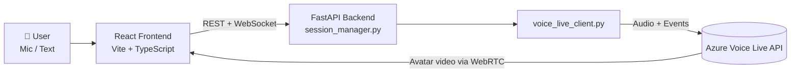

<div align="center">

# 🎙️ Voice Live AI Contact Center

**Talk to an AI agent that talks back, with a real-time animated avatar.**

Built on Azure Voice Live, FastAPI, and React.


</div>

---

## ✨ Overview

Voice Live AI Contact Center is a full-stack reference application for building conversational voice agents. A user speaks (or types), the agent replies with low-latency synthesized speech, and an optional avatar delivers the response with synchronized lip-sync over WebRTC.

The repository ships in three flavors so you can start at whatever level of complexity suits you:

| Mode | Entry point | Best for |
|------|-------------|----------|
| 🌐 **Web app** | `backend/` + `frontend/` | The full experience: avatar video, live transcripts, text and voice input |
| 🎧 **Audio-only terminal** | `voiceagent_audio_only.py` | Fastest way to test a conversation, no avatar or browser needed |
| 🧑‍💻 **Avatar terminal** | `voiceagent.py` | Debugging avatar sessions with detailed event logging |

## 🚀 Features

- **Real-time voice conversation** with an Azure-hosted AI agent
- **Animated avatar** (default: *Lisa*, casual-sitting) streamed over WebRTC
- **Voice and text input** in the same session
- **Live transcription** for both the user and the assistant
- **Clean audio**: 24 kHz streaming with Azure Deep Noise Suppression and server-side echo cancellation
- **Session management** through a REST API plus WebSocket event streaming
- **Responsive, modern UI** built with React, TypeScript, and Vite

## 🧭 Architecture



## 📁 Project Structure

```
voiceagent/
├── voiceagent.py              # Terminal voice agent with avatar support
├── voiceagent_audio_only.py   # Terminal voice agent, direct audio playback
├── test_avatar_batch.py       # Avatar configuration test script
├── requirements.txt           # Python dependencies
├── .env.example               # Environment variable template
├── backend/                   # FastAPI server
│   ├── main.py                # REST + WebSocket API
│   ├── session_manager.py     # Voice Live session lifecycle
│   └── voice_live_client.py   # Azure Voice Live client wrapper
└── frontend/                  # React + TypeScript UI
    ├── index.html
    ├── package.json
    ├── vite.config.ts
    ├── tsconfig.json
    └── src/
        ├── main.tsx           # Entry point
        ├── App.tsx            # Main component
        ├── App.css            # Component styles
        └── index.css          # Global styles
```

## ✅ Prerequisites

- Python 3.8+
- Node.js 18+
- An Azure subscription with access to Azure Voice Live
- Azure credentials available to `DefaultAzureCredential` (see [Authentication](#-authentication))

## ⚡ Quick Start

### 1. Clone

```bash
git clone <your-repo-url>
cd voiceagent
```

### 2. Configure environment

```bash
cp .env.example .env
```

Fill in `.env` with your values:

```env
AZURE_VOICE_LIVE_ENDPOINT=https://your-endpoint.cognitiveservices.azure.com/
AZURE_VOICE_LIVE_AGENT_ID=your-agent-id
AZURE_VOICE_LIVE_AGENT_CONNECTION_STRING=region.api.azureml.ms;workspace-id;resource-group;project-name
AZURE_VOICE_LIVE_API_VERSION=2025-10-01
AZURE_TTS_VOICE=en-IN-AartiIndicNeural
AZURE_VOICE_AVATAR_CHARACTER=lisa
AZURE_VOICE_AVATAR_STYLE=casual-sitting
```

> 🔒 **Never commit `.env`.** Confirm it is listed in `.gitignore`.

### 3. Install dependencies

```bash
pip install -r requirements.txt
cd frontend && npm install && cd ..
```

### 4. Run the web app

Start the backend:

```bash
cd backend
python -m uvicorn main:app --host 0.0.0.0 --port 8000 --reload
```

In a second terminal, start the frontend:

```bash
cd frontend
npm run dev
```

Open the URL Vite prints (typically `http://localhost:5173`).

### 5. Use it

1. Click **Start Session** to initialize the voice agent.
2. Click **Connect Avatar** to open the WebRTC video stream.
3. Speak with the microphone button, or type a message.
4. Watch the avatar respond, with live transcripts for both sides.

## 🖥️ Terminal Modes

Useful for quick tests without the browser:

```bash
python test_avatar_batch.py        # Validate avatar configuration
python voiceagent_audio_only.py    # Reliable voice chat with direct audio playback
python voiceagent.py               # Avatar session with enhanced event logging
```

> ℹ️ In avatar mode, audio is delivered over WebRTC, so it will not play directly in the terminal. Use the audio-only script for that. Press `q` + Enter to quit.

## ⚙️ Configuration

| Variable | Description | Required |
|----------|-------------|:--------:|
| `AZURE_VOICE_LIVE_ENDPOINT` | Azure Voice Live endpoint URL | ✅ |
| `AZURE_VOICE_LIVE_AGENT_ID` | Your agent ID | ✅ |
| `AZURE_VOICE_LIVE_AGENT_CONNECTION_STRING` | Agent connection string | ✅ |
| `AZURE_VOICE_LIVE_API_VERSION` | API version, e.g. `2025-10-01` | ✅ |
| `AZURE_TTS_VOICE` | Azure TTS voice name | ✅ |
| `AZURE_VOICE_AVATAR_CHARACTER` | Avatar character, e.g. `lisa` | ✅ |
| `AZURE_VOICE_AVATAR_STYLE` | Avatar style, e.g. `casual-sitting` | ✅ |
| `AZURE_VOICE_AVATAR_WIDTH` | Video width in pixels (default setup: 1280) | ✅ |
| `AZURE_VOICE_AVATAR_HEIGHT` | Video height in pixels (default setup: 720) | ✅ |
| `AZURE_VOICE_AVATAR_BITRATE` | Video bitrate (default setup: 2 Mbps) | ✅ |
| `AZURE_VOICE_AVATAR_ICE_URLS` | Custom ICE/TURN servers | ➖ |

## 🔐 Authentication

The app uses [`DefaultAzureCredential`](https://learn.microsoft.com/azure/developer/python/sdk/authentication/overview) and requests tokens for both `https://ai.azure.com/.default` and `https://ml.azure.com/.default`, with automatic refresh. Authenticate using any one of:

- **Azure CLI:** `az login` (simplest for local development)
- **Environment variables:** `AZURE_CLIENT_ID`, `AZURE_TENANT_ID`, `AZURE_CLIENT_SECRET`
- **Managed Identity:** when deployed on Azure

## 🔌 API Reference

| Method | Endpoint | Description |
|--------|----------|-------------|
| `POST` | `/api/session` | Create a new voice session |
| `GET` | `/api/session/{session_id}` | Get session status |
| `POST` | `/api/session/{session_id}/avatar/connect` | Connect the avatar via WebRTC |
| `POST` | `/api/session/{session_id}/message` | Send a text message |
| `WS` | `/api/ws/{session_id}` | Stream real-time events |

## 🛠️ Troubleshooting

<details>
<summary><b>Avatar not connecting</b></summary>

- Confirm your browser supports WebRTC.
- Check firewall rules for UDP traffic.
- Review your ICE server configuration (`AZURE_VOICE_AVATAR_ICE_URLS`).
</details>

<details>
<summary><b>No audio</b></summary>

- In the terminal, use `voiceagent_audio_only.py`; the avatar script streams audio via WebRTC only.
- In the browser, check microphone permissions and that no other app is using the mic.
- Open the browser console for errors.
</details>

<details>
<summary><b>Session or WebSocket connection fails</b></summary>

- Verify every environment variable is set and correct, especially the agent ID and connection string.
- Confirm your Azure credentials are valid (`az login`).
- Check the backend logs for details.
</details>

<details>
<summary><b>Enable verbose logging</b></summary>

```python
import logging
logging.basicConfig(level=logging.DEBUG)
```
</details>

## 👩‍💻 Development

| To change... | Edit |
|--------------|------|
| API routes, WebSocket handling | `backend/main.py` |
| Session lifecycle | `backend/session_manager.py` |
| Voice agent / Azure client logic | `backend/voice_live_client.py` |
| UI and behavior | `frontend/src/App.tsx` |

**Production build**

```bash
# Frontend
cd frontend && npm run build

# Backend
pip install gunicorn
gunicorn backend.main:app -w 4 -k uvicorn.workers.UvicornWorker
```

## 🤝 Responsible Use

This project handles live voice audio and presents an AI persona. If you deploy it, please:

- **Disclose that users are talking to an AI**, not a human.
- **Obtain consent** before recording or transcribing conversations, and follow applicable privacy laws (e.g. GDPR).
- **Protect data**: keep credentials out of source control, and limit retention of audio and transcripts.
- **Comply with Azure's terms** and the [Azure AI Services responsible-use guidelines](https://learn.microsoft.com/azure/ai-services/responsible-use-of-ai-overview).

## 🧑‍🤝‍🧑 Contributing

Pull requests are welcome. Before committing, make sure all secrets, keys, and personal data are removed.

## 📄 License

Released under the [MIT License](LICENSE).
